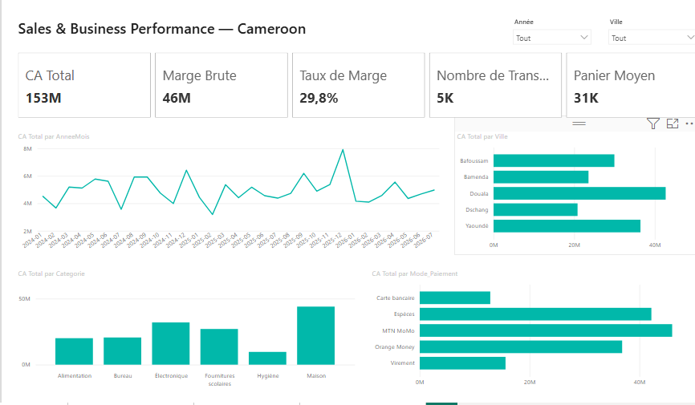
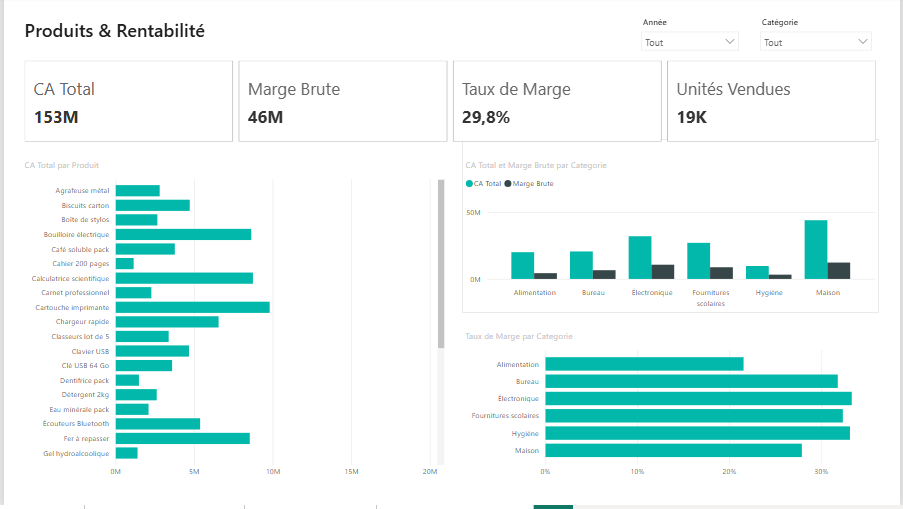
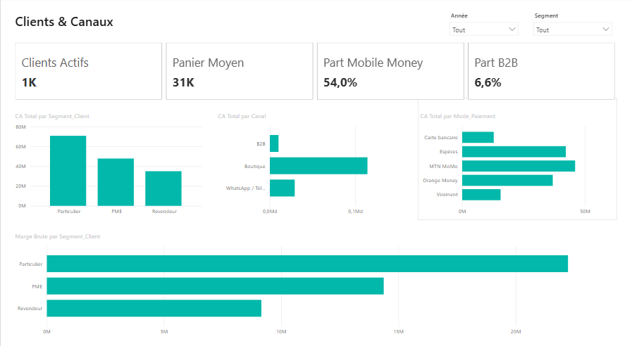
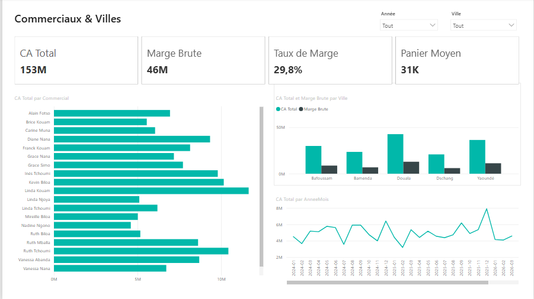

# 🇨🇲 Sales & Business Performance Analytics — Cameroon

Projet portfolio **Data Analytics / Business Intelligence** de bout en bout, construit autour d'une entreprise camerounaise fictive de distribution.

**Workflow : Excel → SQLite / SQL → Python & Pandas → Power BI → Recommandations métier**



## 🎯 Problématique métier

> Comment une entreprise de distribution peut-elle exploiter ses données pour améliorer son chiffre d'affaires, sa rentabilité et ses décisions commerciales ?

Le projet analyse les performances par ville et période, la rentabilité des produits, les segments clients, les canaux, les commerciaux, les remises et les moyens de paiement, notamment le Mobile Money.

## 📊 Données

- **5 000 transactions synthétiques** ;
- période : **2024–2026** ;
- villes : Douala, Yaoundé, Bafoussam, Dschang et Bamenda ;
- aucune donnée d'entreprise ou de personne réelle.

Les données Excel, la table de faits SQLite et le modèle Power BI ont été **synchronisés sur le même jeu de 5 000 transactions**.

## 🛠️ Stack technique

| Outil | Utilisation |
|---|---|
| Excel | Données source, dictionnaire et guide KPI |
| SQLite | Base relationnelle |
| SQL | Jointures, agrégations, CTE, fonctions de fenêtre |
| Python / Pandas | Analyse, contrôles qualité et transformations |
| Matplotlib | Visualisation exploratoire |
| Jupyter | Notebook reproductible |
| Power BI | Dashboard décisionnel interactif |
| DAX | Mesures et KPI |
| Git / GitHub | Versionnement et portfolio |

## 🗂️ Structure du repository

```text
Sales-Business-Performance-Cameroon/
├── data/
│   ├── README.md
│   ├── raw/sales_performance_cameroon.xlsx
│   └── database/sales_performance_cameroon.db
├── notebooks/
│   ├── Projet_01_SQL_Python.ipynb
│   └── Projet_01_SQL_Python_EXECUTE.ipynb
├── sql/
│   ├── schema_database.sql
│   └── analyse_sales_performance.sql
├── powerbi/
│   ├── Sales_Business_Performance_Cameroon.pbip
│   ├── Sales_Business_Performance_Cameroon.Report/
│   ├── Sales_Business_Performance_Cameroon.SemanticModel/
│   ├── PowerBI_Mesures_DAX.txt
│   ├── OUVRIR_DANS_POWER_BI.txt
│   └── theme/PowerBI_Theme_Cameroon.json
├── images/
│   ├── dashboard_01_executive_overview.png
│   ├── dashboard_02_products_profitability.png
│   ├── dashboard_03_customers_channels.png
│   └── dashboard_04_sales_force_geography.png
├── docs/
│   ├── PROJECT_QA.md
│   └── powerbi/
├── requirements.txt
├── .gitignore
└── README.md
```

## 📈 Dashboard Power BI

### 1. Vue générale


KPI globaux, évolution du chiffre d'affaires, performances par ville, catégorie et moyen de paiement.

### 2. Produits & Rentabilité



Analyse des produits, catégories, chiffre d'affaires et marges.

### 3. Clients & Canaux



Segments clients, canaux de vente, comportements de paiement et Mobile Money.

### 4. Commerciaux & Villes



Analyse de la force de vente et des performances géographiques.

## 📐 Mesures DAX

Exemples :

```DAX
CA Total =
SUM(SalesTable[CA_Net_FCFA])
```

```DAX
Marge Brute =
SUM(SalesTable[Marge_Brute_FCFA])
```

```DAX
Taux de Marge =
DIVIDE([Marge Brute], [CA Total], 0)
```

Toutes les mesures sont documentées dans `powerbi/PowerBI_Mesures_DAX.txt`.

## 🔎 Analyse SQL

Le fichier `sql/analyse_sales_performance.sql` présente notamment :

- `SELECT`, `WHERE`, `GROUP BY`, `ORDER BY` ;
- `JOIN` et `HAVING` ;
- `SUM`, `AVG`, `COUNT` ;
- CTE ;
- fonctions de fenêtre comme `LAG`.

Exemple :

```sql
SELECT
    s.ville,
    ROUND(SUM(f.ca_net_fcfa), 0) AS chiffre_affaires_fcfa
FROM fact_sales f
JOIN dim_store s ON f.store_id = s.store_id
GROUP BY s.ville
ORDER BY chiffre_affaires_fcfa DESC;
```

## 🐍 Python / Pandas

Notebook principal : `notebooks/Projet_01_SQL_Python.ipynb`  
Version exécutée : `notebooks/Projet_01_SQL_Python_EXECUTE.ipynb`

Logique d'analyse : **SQL → Pandas → Visualisation → Interprétation métier**.

## ▶️ Exécution locale

### Python

```bash
python -m venv .venv
```

Sous Windows :

```bash
.venv\Scripts\activate
pip install -r requirements.txt
jupyter notebook
```

Puis ouvrir `notebooks/Projet_01_SQL_Python.ipynb`.

### Power BI

1. Ouvrir le dossier `powerbi/`.
2. Double-cliquer sur `Sales_Business_Performance_Cameroon.pbip`.
3. Laisser Power BI Desktop charger le modèle et le rapport.

## 💡 Questions métier traitées

- Quelle ville contribue le plus au chiffre d'affaires ?
- Quels produits génèrent beaucoup de ventes mais peu de marge ?
- Quels segments ont les paniers moyens les plus élevés ?
- Quelle part du CA provient du Mobile Money ?
- Quel est l'effet des remises sur la marge ?
- Quels commerciaux créent le plus de valeur ?
- Quelles périodes concentrent les pics de ventes ?

## 🎓 Compétences démontrées

**SQL :** modélisation relationnelle, jointures, agrégations, CTE et fonctions de fenêtre.  
**Python :** SQLite, Pandas, contrôle qualité, agrégations et analyse temporelle.  
**Business Intelligence :** KPI, DAX, Power BI, storytelling et aide à la décision.  
**Data quality :** contrôle de cohérence Excel ↔ SQLite ↔ Power BI.

## ✅ Statut

- [x] Dataset Excel synthétique
- [x] Base SQLite
- [x] Analyse SQL
- [x] Notebook Python / Pandas
- [x] Notebook exécuté
- [x] Projet Power BI au format PBIP
- [x] Mesures DAX
- [x] Captures du dashboard
- [x] Documentation
- [x] Fichiers Power BI locaux/cache exclus
- [x] Données synchronisées entre Excel, SQLite et Power BI
- [x] Structure prête pour GitHub

## 👤 Auteur

**Mouliom Djidere Askanda**  
Portfolio orienté **Data Analytics • Business Intelligence • Data / IA**.

## ⚠️ Disclaimer

Toutes les données de ce repository sont synthétiques et ont été créées uniquement pour l'apprentissage et le portfolio. Elles ne représentent pas l'activité, les clients ou les finances d'une organisation réelle.
